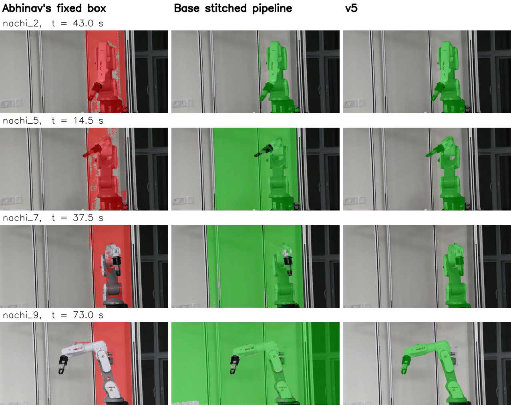
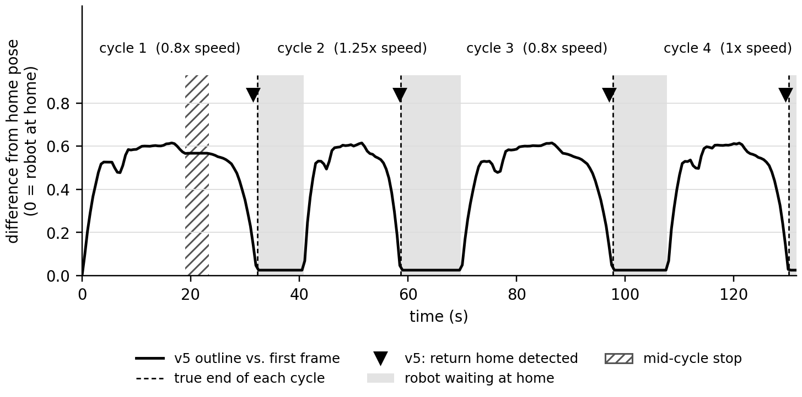

# SAM-Box PoseRAC: counting robot work cycles from video

Counts the work cycles of an industrial robot arm (Nachi) filmed by a fixed camera, with no labelled training data.

Each frame, [SAM](https://github.com/facebookresearch/segment-anything) (ViT-Base) outlines the robot, prompted by a box that follows the robot plus one click on its base. Each outline is compared with the robot's outline on the first frame (its home pose). The two-threshold trigger from [PoseRAC](https://github.com/MiracleDance/PoseRAC) then counts each home → away → home trip as one cycle. The pipeline also reports the time of each return home.

The current version is **v5** (git tag `v5`).

**Before changing anything, read [`HISTORY.md`](HISTORY.md).** It lists every version, what each change fixed or broke,
what was tried and dropped, the known failures, and the fixes proposed but not yet tested. Before calling a change an
improvement, run the [regression check](#regression-check).

## Results

**All 200 videos of the Nachi dataset** (199,161 frames at 2 fps, 3,141 cycles, 1–30 cycles per video):

| Method | Exact count | OBO (within ±1) | MAE | Mean error (cycles) | RMSE |
| --- | --- | --- | --- | --- | --- |
| **v5 (this repo)** | **98.5%** (197/200) | **100%** | **0.002** | **0.01** | **0.12** |
| Fixed-box SAM + area autocorrelation (earlier pipeline) | 83.5% (167/200) | 83.5% | 0.221 | 2.27 | 5.88 |
| Fixed-box outlines + v5 counter | 70.5% | 81.5% | 0.158 | 2.19 | 5.58 |
| v5 outlines + autocorrelation | 83.5% | 84.0% | 0.143 | 2.12 | 5.86 |

MAE is the PoseRAC/RepCount definition, mean(|predicted − true| / true).

- v5's three misses are nachi_4_seq_014, 016 and 018. Each is one cycle short.
- On videos with 21–30 cycles, v5 is 100% exact and the earlier pipeline is 67%.
- v5 outlines cover 9.1% of the picture on average, against 15.3% for the fixed box. The fixed box picks up strips of wall.
- Sudden outline jumps: 715 for v5, 10,402 for the fixed box.
- The earlier pipeline's numbers come from our re-implementation of it.
- Full numbers: [`results/dataset_200/metrics.txt`](results/dataset_200/metrics.txt). Per video: [`per_video.csv`](results/dataset_200/per_video.csv).

**Edited test videos with uneven cycles** (9 videos, 33 cycles). Built from the real one-cycle recordings, each cycle runs at 0.8×, 1× or 1.25× speed, the robot waits 0–15 s at home between cycles, and 3 videos also stop mid-cycle:

| | Exact count |
| --- | --- |
| **v5** | **9/9** |
| Fixed-box SAM + autocorrelation | 6/9 |

All 33 cycle ends were detected exactly once, with a median of 0.8 s early.

**Development set** (the 10 real videos used while building v5): v5 gets 10/10, and the base stitched pipeline (v1) gets 5/10.





**Important caveats**

- **The dataset repeats itself.** All 200 dataset videos are built from the same 10 one-cycle recordings, repeated back to back, so every cycle within a video is pixel-identical.
- **v5 is not independent of the dataset.** v5 was developed on 10 of those videos, so the 200-video result shows it holds up on longer videos but is not an independent test. The edited videos are the fairest test here.
- **New footage is still needed.** A new recording of the robot running several cycles in a row is the next real test.

## How v5 works

1. **Set up once per camera.** Draw a box around the robot on the first frame and click once on its base; the robot should be at home in that frame. These are stored in `configs/*.json`.
2. **Track the robot outline every frame (SAM ViT-B, 2 fps).**
   - **Candidates:** the box around the last good outline, and a second box that also covers movement near the robot. Each box gives 3 SAM outlines, so 6 candidates.
   - **Clean-up:** specks, thin slivers and small detached pieces are removed.
   - **Checks:** an outline is rejected if it adds a static region, meaning new area where the picture did not change since the last good outline (the camera is fixed, so a wall panel fails). It is also rejected if its size is outside 0.5–2× the recent size or 0.4–2× the first-frame size.
   - **Choice:** the candidate most like the last good outline is used.
   - **Getting unstuck:** if nothing passes for 1 s, it also tries the first-frame box and a box around everything that moved.
   - **Fallback:** if nothing passes at all, the last good outline is kept.
3. **Count cycles.** Measure the difference between each outline and the first-frame outline. A cut-off picked automatically from the data (Otsu's method) turns it into a home score, and PoseRAC's smoothed two-threshold trigger (on above 0.78, off below 0.4) counts each home → away → home trip.

Version history (v1 to v5, with results and side effects): [`HISTORY.md`](HISTORY.md). Earlier tracker versions are in
`history/`.

## Repository layout

```
HISTORY.md              the truth sheet: versions, what was tried, known failures, proposed fixes, ground rules
src/
  count_video.py        count cycles in any video (no ground truth needed)
  run_real.py           v5 pipeline + evaluation on folders of frames with ground truth
  regression_check.py   compare the current code with v5 on the 10 development + 9 edited videos
  run_batch.py          run v5 over many dataset videos (used for the 200-video run)
  score_200.py          metrics: exact, OBO, MAE, RMSE, bias, per program, per cycle range, boundaries
  analyze_real.py       scoring for the 10 real videos
  analyze_edited.py     scoring for the edited test videos
  make_edited_tests.py  builds the edited test videos from the one-cycle clips (fixed seed)
  poserac.py            PoseRAC model, loss and official counting trigger (ported)
  features.py           outline -> features (11x9 occupancy grid, geometry)
  evaluate.py           synthetic-benchmark evaluation; Otsu threshold used by the counter
  run_sam.py, reproduce.py, experiments.py, synth/, assets/   synthetic benchmark
configs/                box + base click per camera setup (real videos, dataset programs, edited set)
hpc/                    SLURM scripts for the lab cluster (setup, 200-video run, regression check)
history/                run_real_v1.py ... run_real_v4.py (v5 is src/run_real.py)
results/
  real_10_v5/           v5 on the 10 development videos: results, ground truth, outlines (used by the regression check)
  edited_9/             v5 on the 9 edited videos: results, ground truth, outlines (used by the regression check)
  dataset_200/          v5 on all 200 videos: metrics + per-video results
reports/                PDF reports (black on white)
docs/figures/           figures used above and in HISTORY.md
```

## Setup

```bash
python -m venv .venv && source .venv/bin/activate
pip install -r requirements.txt
mkdir -p src/weights
curl -L -o src/weights/sam_b.pt https://github.com/ultralytics/assets/releases/download/v8.2.0/sam_b.pt
# md5 01ec64d29a2fca3f0661936605ae66f8 (the same weights as Meta's sam_vit_b_01ec64.pth)
```

Runs on CUDA, Apple Silicon (`--device mps`) or CPU. Measured speeds:

| Device | Speed |
| --- | --- |
| RTX PRO 6000 | about 0.12 s per frame |
| Apple M3 | about 1.2 s per frame |
| CPU (2 cores) | 15–25 s per frame |

## Usage

**Count cycles in a new video.** The box and click are in 1280×720 pixel coordinates on the reference frame:

```bash
python src/count_video.py --video clip.mp4 --box 430 180 950 719 --click 754 598 --out result.json
```

To get the box and click, save the first frame at 1280×720 and read the pixel positions off it in any image viewer
that shows coordinates:

```bash
ffmpeg -i clip.mp4 -vf scale=1280:720 -frames:v 1 first.png
```

- The **box** should hug the robot tightly. A loose box makes SAM pick the wall (see HISTORY.md, Section 2).
- The **click** goes on the robot's base.
- The robot must be **at its home pose and fully visible** in that frame. If the video starts with a fade or the robot
  is mid-move, pick a later frame and pass `--init_frame <frame index at 2 fps>`.
- The output gives the cycle count, the time of each return home, the outline size and the number of held frames.
  An outline far above ~10–15% of the frame, or many held frames, means the tracker has lost the robot.
- Known weak spot: a robot that never pauses at home, or very short cycles, at 2 fps (HISTORY.md, Section 6.2).

**Re-run the 10 real videos.** Each folder needs `frames/000001.jpg...` (extracted at 2 fps, 1280×720) and `gt.json`:

```bash
ffmpeg -i nachi_1_seq_007.mp4 -vf fps=2,scale=1280:720 -q:v 3 -start_number 1 data/real/nachi_1_seq_007/frames/%06d.jpg
python src/run_real.py --root data/real --setup configs/real_setup.json --device cuda
python src/analyze_real.py data/real        # needs data/real/setup.json (copy of configs/real_setup.json)
```

**Build and run the edited test set:**

```bash
NACHI_CLIPS=/path/to/nachi_robot_videos_trim python src/make_edited_tests.py data/edited
cp configs/edited_setup.json data/edited/setup.json
python src/run_real.py --root data/edited --setup data/edited/setup.json --device cuda
python src/analyze_edited.py data/edited
```

**On the lab cluster.** Clone the repo, choose your own working folder, and run the set-up once. Set-up is light
work, so it is fine on the login node. Everything heavy goes through SLURM.

```bash
export WORK=/scratch/psaxena/<your_name>_poserac      # your own folder; never someone else's
bash hpc/setup_hpc.sh                                 # SAM weights, 3 small packages into $WORK/pylib, video lists
```

It uses the shared `krishna` conda environment read-only. Never install into a shared environment. `/scratch` is
cleared after about 15 days: re-run the set-up if `$WORK` is gone, and copy results you want to keep into the repo.

**Run the full 200-video dataset on SLURM.** Run from the repo folder. Start 1–3 jobs at most; they share the work and
skip finished videos:

```bash
sbatch -p <gpu partition> -o $WORK/logs/%x_%j.out --export=ALL,WORK=$WORK hpc/run_shard.sbatch queue.txt
python src/score_200.py $WORK/results $WORK/lists/all.txt     # also runs automatically at the end of each job
```

The v5 run took 3 h 47 min on two GPUs.

**Synthetic benchmark:**

```bash
pip install -r requirements-synthetic.txt
python src/reproduce.py --model vitb
```

It renders a Nachi-like arm into a photo of the real empty cell, with exact ground truth.

## Regression check

Every change must keep (or improve) v5's results on the 10 development and 9 edited videos. The check prints one row
per video (true count, v5, new, status) and ends with PASS or FAIL. It fails if any count gets further from the truth,
or if a video v5 got right is now wrong.

```bash
# changes to counting only (home score, thresholds, smoothing): seconds, no GPU, uses the stored v5 outlines
python src/regression_check.py recount

# changes to tracking: full pipeline on the cluster (the first run also builds the input frames)
sbatch -p <gpu partition> -o $WORK/logs/%x_%j.out --export=ALL,WORK=$WORK hpc/regression_check.sbatch <run_name>
cat $WORK/regression_runs/<run_name>/regression_report.txt

# a single video, for a quick look while developing (not a pass)
python src/regression_check.py recount --only nachi_7_seq_008
```

Passing the check is necessary, not sufficient. Also run the 200 videos for any change you want to keep, and record
the outcome in `HISTORY.md`.

## Working together

- **`main` always holds a version that passed the regression check.** `v5` is tagged and never moves.
- **Work on your own branch** (e.g. `abhinav/static-fix`). One change per branch where possible.
- **Before merging:**
  - run the regression check;
  - add an entry to `HISTORY.md` (template at the end), including what didn't work;
  - give it a version number (`v6`, `v6.1`, ...).

  Tag the merge with that number.
- **Fixes must be general.** No special cases for one robot, part, colour or video, and no settings tuned on the test
  videos (HISTORY.md, Sections 7–8).
- **Keep results you rely on in the repo** under `results/<version>/` (metrics and per-video results; not frames or
  videos).

## Data

The Nachi videos and ground truth are not included. They are the lab's dataset: 10 one-cycle recordings, 200 generated multi-cycle videos in `dataset_out/`.

## Credits

- **SAM:** Kirillov et al., *Segment Anything*, ICCV 2023.
- **PoseRAC:** Yao, Cheng and Zou, *PoseRAC: Pose Saliency Transformer for Repetitive Action Counting*, arXiv:2303.08450, 2023. Its counting trigger and model are ported in `src/poserac.py`.
- **Fixed-box baseline:** the fixed-box SAM + area-autocorrelation pipeline is Abhinav's earlier work, re-implemented here for comparison.
